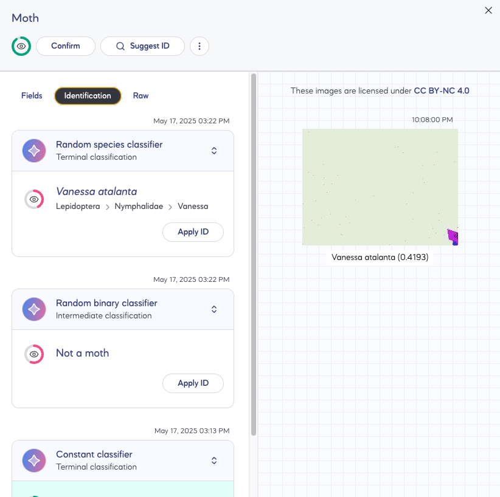
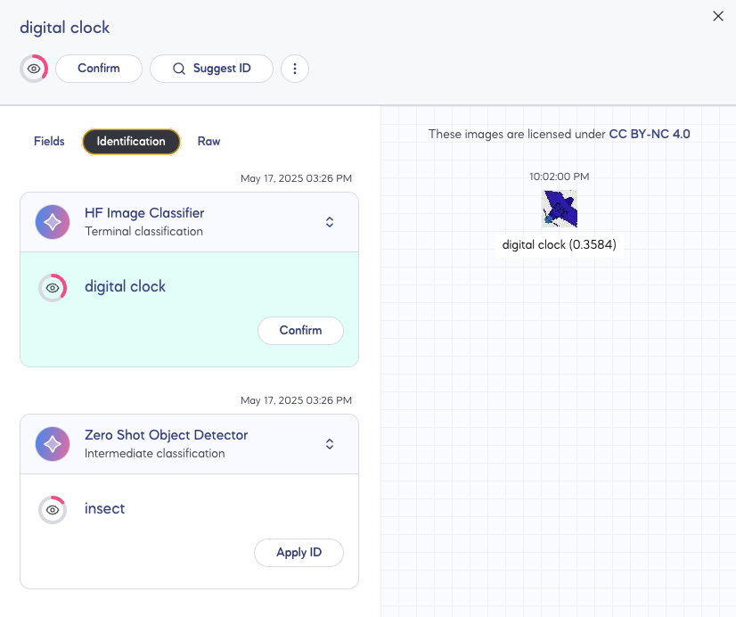
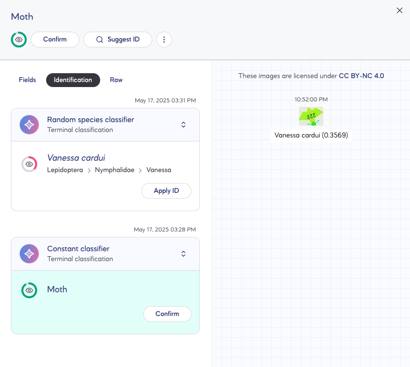

# Set-Up Custom ML Backends and Models

## Background

A processing service or ML backend is a group of pipelines used to process images. In real life, the ML backend can be hosted on a separate server where it handles processing the source images, compiling the models, and running inference.

In this directory, we define locally-run processing services as FastAPI apps. A basic ML backend has the following endpoints:
- `/info`: returns data about what pipelines and algorithms are supported by the service.
- `/livez`
- `/readyz`
- `/process`: receives source images and existing detections via a `PipelineRequest` and returns a `PipelineResponse` containing detections

`processing_services` contains 2 apps:
- `example`: demos how to add custom pipelines/algorithms.
- `minimal`: a simple ML backend for basic testing of the processing service API. This minimal app also runs within the main Antenna docker compose stack.

If your goal is to run an ML backend locally, simply copy the `example` app and follow the steps below.

## v1 vs v2 processing services

Antenna supports two processing-service paradigms:

- **v1 (push / synchronous):** the service exposes `/info`, `/livez`, `/readyz`, `/process`. Antenna POSTs a `PipelineRequest` to `/process` when a job runs. Good for interactive/playground requests on a single image and for exposing pipeline schema at `/api/v2/docs/`.
- **v2 (pull / async / worker):** a worker polls Antenna's job-queue HTTP endpoints (`POST /api/v2/jobs/{id}/tasks/`, `POST /api/v2/jobs/{id}/result/`) and processes tasks queued by Antenna in NATS JetStream. Antenna proxies NATS internally so the worker only talks HTTP. Good for long-running workloads, firewall-isolated GPU fleets, and horizontal scaling.

The `minimal` container supports **both modes** and is driven by a `MODE` env var:

- `MODE=api` (default; what CI uses) — v1 FastAPI only.
- `MODE=worker` — v2 worker poll loop only.
- `MODE=api+worker` — both, in one container. Used by `processing_services/docker-compose.yml` for local dev. Exercises the real v2 pull path (Redis / NATS / Celery / Celery Beat) with lightweight stub pipelines, no ML dependencies.

See `docs/claude/planning/2026-04-17-minimal-worker-design.md` for the design.

### Running the v2 path locally

```bash
docker compose up -d                                             # Antenna core
docker compose -f processing_services/docker-compose.yml up -d   # minimal container in api+worker mode
```

The minimal container self-registers a `ProcessingService` (no `endpoint_url`, async-mode) against the "Default Project" seeded by `ami/main/management/commands/ensure_default_project.py`. Submit an `async_api` job for the `constant` or `random-detection-random-species` pipeline and the worker picks it up.


## Environment Set Up

1. Update `processing_services/example/requirements.txt` with required packages (i.e. PyTorch, etc)
2. Rebuild container to install updated dependencies. Start the minimal and example ML backends: `docker compose -f processing_services/docker-compose.yml up -d --build ml_backend_example`
3. To test that everything works, register a new processing service in Antenna with endpoint URL http://ml_backend_example:2000. All ML backends are connected to the main docker compose stack using the `antenna_network`.


## Add Algorithms, Pipelines, and ML Backend/Processing Services

1. Define algorithms in `processing_services/example/api/algorithms.py`.
    - Each algorithm has a `compile()` and `run()` function.
    - Make sure to update `algorithm_config_response`.
    - `compile()` function should handle loading the saved model from cache
2. Define a new pipeline class (i.e. `NewPipeline`) in `processing_services/example/api/pipelines.py`
    Implement/Update:
    - `stages` (a list of algorithms in order of execution -- typically `stages = [Localizer(), Classifier()]`)
        - For dynamic loading of stages, which is useful for passing the pipeline request's `config`, implement `get_stages()`. A good example of this is in the `ZeroShotObjectDetectorPipeline` class.
    - `batch_size` (a list of integers representing the number of entities that can be processed at a time by each stage -- i.e. [1, 1] means that the localizer can process 1 source image a time and the classifier can process 1 bounding box/detection at a time)
    - `config`
3. Implement the `run()` function. Some important considerations:
    - Always run `_get_pipeline_response` at the end of `run()` to get a valid `PipelineResultsResponse`
    - Each algorithm/stage in a pipeline should take a list of `SourceImage`s or `Detection`s and produce a list of `Detection`s (with or without classifications). The class member function `_get_detections()` handles this general stage structure; it batchifys the inputs and produces output detections.
    - 4 example pipelines are already implemented. See the table at the end of the README for examples of what detections from each pipeline look like.
        - `ZeroShotHFClassifierPipeline`
        - `ZeroShotObjectDetectorPipeline`
        - `ZeroShotObjectDetectorWithRandomSpeciesClassifierPipeline`
        - `ZeroShotObjectDetectorWithConstantClassifierPipeline`

4. Add `NewPipeline` to `processing_services/example/api/api.py`

```
from .pipelines import (
    Pipeline,
    ZeroShotHFClassifierPipeline,
    ZeroShotObjectDetectorPipeline,
    ZeroShotObjectDetectorWithConstantClassifierPipeline,
    ZeroShotObjectDetectorWithRandomSpeciesClassifierPipeline,
    NewPipeline
)
...

pipelines: list[type[Pipeline]] = [
    ZeroShotHFClassifierPipeline,
    ZeroShotObjectDetectorPipeline,
    ZeroShotObjectDetectorWithConstantClassifierPipeline,
    ZeroShotObjectDetectorWithRandomSpeciesClassifierPipeline,
    NewPipeline,
]
```
5. Update `PipelineChoice` in `processing_services/example/api/schemas.py` to include the slug of the new pipeline, as defined in `NewPipeline`'s config.

```
PipelineChoice = typing.Literal[
    "zero-shot-hf-classifier-pipeline",
    "zero-shot-object-detector-pipeline",
    "zero-shot-object-detector-with-constant-classifier-pipeline",
    "zero-shot-object-detector-with-random-species-classifier-pipeline",
    "new-pipeline-slug",
]
```

## Processing service contract: feature vectors and request config

This section describes what Antenna expects from a service that returns feature vectors or reads per-request settings. The `minimal` service implements all of it and is the reference to copy from.

### Registering algorithms

`/info` must list every algorithm whose key can appear in a response: the detector, each classifier, and any feature extractor. Antenna rejects a batch that names an algorithm the pipeline did not register. A detector has a `task_type` of `"detection"` or `"localization"`. A feature extractor has a `task_type` of `"embedding"` and no category map.

### Returning feature vectors

Vectors are returned on `DetectionResponse.embeddings`, a list of objects with a `features` list of floats and an `algorithm` reference (`name` and `key`). A detection carries at most one vector per algorithm, every vector from one algorithm has the same length, and only vectors from the same algorithm are comparable with each other. `ClassificationResponse` has no features field in Antenna, so the `include_features` option of the AMI Data Companion has no equivalent and is not stored.

### Request config

In synchronous (push) mode, the request `config` holds the pipeline's default config merged with the project's pipeline config. Services should read these keys and ignore every other key, because Antenna also sends keys meant only for itself, such as `request_source_image_batch_size`.

| Key | Default | Meaning |
|----|----|----|
| `include_logits` | `true` | Return the raw logits with each classification. Turn off to shrink large responses. |
| `features_for_all_detections` | `false` | Attach the terminal classifier's own feature vector to every detection, as an embedding keyed by that classifier. |
| `embedding_extractor` | `null` | `null` runs the pipeline's own extractor if it has one, `""` turns the extractor off, and any other key the pipeline does not offer should be rejected with a 422. |

### Feature-only pipelines

A feature-only pipeline receives detections and returns each one unchanged (bounding box, algorithm reference, and `crop_image_url`) with one embedding and no classifications. Detections with no box, or an empty one, are skipped. Antenna matches the returned detections to its own by capture and box, so altering either would orphan the vector. These pipelines list a detector and a feature extractor in `/info`, as the AMI Data Companion does. When a request carries no detections, the pipeline detects first.

### Choosing which pipelines to offer

`AMI_PIPELINES` is a comma-separated list of pipeline slugs to offer. An empty value offers all of them, and an unknown slug stops the service at startup.

### Pull (async) mode

Tasks fetched in pull mode do not carry the request config yet (see #1422). A worker therefore reads `AMI_INCLUDE_LOGITS`, `AMI_FEATURES_FOR_ALL_DETECTIONS`, and `AMI_EMBEDDING_EXTRACTOR` from its environment instead. They follow the request config rules: an unset `AMI_EMBEDDING_EXTRACTOR` runs each pipeline's own extractor and an empty one turns extractors off, so leave the variable out rather than setting it to an empty value by accident. The extractor setting applies only to pipelines that offer an extractor, and a key no pipeline offers stops the worker at startup. Until pull-mode tasks carry the project's pipeline config, the same project can get different vectors in push and pull mode: push mode follows the project's config, pull mode the worker's environment. Feature-only pipelines are push-only, so the worker neither registers nor polls for them. The worker lists unfinished jobs for all of its pipelines in one call (`pipeline__slug__in`, `ids_only`, `incomplete_only`, `dispatch_mode=async_api`), the same query the AMI Data Companion worker makes; Antenna records that call as the worker's heartbeat.

### The `minimal` service as a reference

The `constant-feature-extractor` algorithm returns 8 values per detection, derived from the capture and the box, so the output is deterministic and needs no model weights. Classifier vectors returned for `features_for_all_detections` have 4 values. The pipelines `constant-with-feature-extractor` and `constant-feature-extractor-only` show the two shapes described above. To run the tests, execute `python -m unittest api.test worker.test_worker` inside the service container.

## Demo

## `minimal` Pipelines and Output Images

- `ConstantPipeline` and `RandomDetectionRandomSpeciesPipeline`



## `example` Pipelines and Output Images

- `ZeroShotHFClassifierPipeline`


- `ZeroShotObjectDetectorWithRandomSpeciesClassifierPipeline` and `ZeroShotObjectDetectorWithConstantClassifierPipeline` (using reprocessing, skips the Zero Shot Object Detector if there are existing detections)

